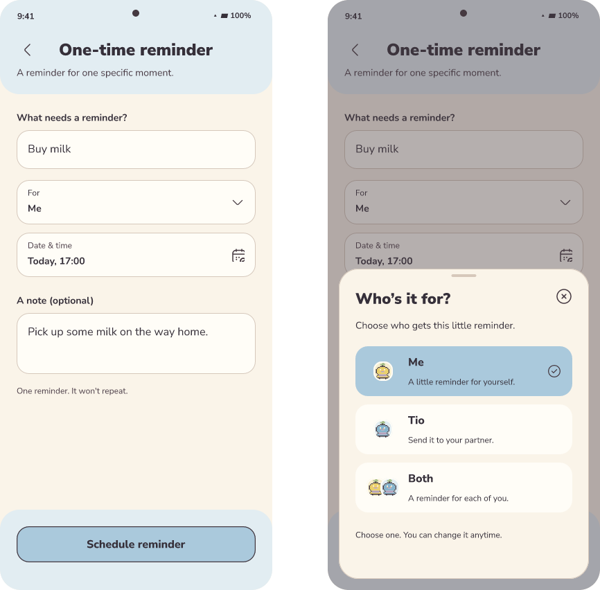

<div align="center">
  

  <h1>Alongio</h1>

  <p><strong>Your day. Your way. Better together.</strong></p>
  <p>Teman kecil untuk mengingat hal sehari-hari, membangun rutinitas, dan saling memberi perhatian.</p>

  <p>
    <a href="#preview-desain">Preview</a> ·
    <a href="#status-pengembangan">Status</a> ·
    <a href="#teknologi">Teknologi</a> ·
    <a href="#menjalankan-proyek">Jalankan proyek</a>
  </p>

  <p><strong>Personal project · Mobile app · Sedang dikembangkan</strong></p>
</div>

---

## Tentang Alongio

Alongio adalah aplikasi lifestyle untuk individu dan pasangan, dibangun dengan **React Native, Expo, dan TypeScript**. Idenya berangkat dari hal sederhana: pengingat membeli susu, rutinitas kecil yang ingin dijaga, dan perhatian kepada pasangan seharusnya terasa ringan untuk dilakukan.

Pengalaman produknya dirancang tetap berguna saat digunakan sendiri, dengan ruang untuk berbagi bersama pasangan. Warna pastel, maskot pixel, dan bahasa yang personal menjadi bagian dari identitasnya.

Sebagai proyek portfolio, Alongio menjadi tempat untuk mengeksplorasi **desain produk, alur mobile, komponen reusable, pengelolaan form, navigasi, dan animasi antarmuka** dari desain hingga implementasi.

> **Status saat ini:** prototype frontend dengan data contoh lokal. Backend, autentikasi sungguhan, sinkronisasi pasangan, penyimpanan reminder, dan pengiriman notifikasi belum terintegrasi. Preview di bawah merupakan desain produk; sebagian tampilannya masih dalam proses implementasi.

## Preview desain

### Tiny Planner — pengingat dan rutinitas punya tempatnya sendiri


**Today** menampung reminder sekali jalan, seperti membeli susu atau mengambil paket. **Routines** dirancang untuk aktivitas berulang dengan progres harian dan apresiasi ketika rutinitas hari itu selesai. Menyelesaikan reminder tidak menambah progres rutinitas.

### Pilih penerima tanpa membuat form terasa penuh



Field **For** membuka bottom sheet untuk memilih diri sendiri, pasangan, atau keduanya. Nama, avatar, dan deskripsi singkat membantu menjelaskan pilihan tanpa mengandalkan warna saja.

*Kedua gambar merupakan ekspor desain FigCraft, bukan screenshot aplikasi yang sudah dirilis.*

## Keputusan produk dan UI

| Kebutuhan | Pendekatan desain |
| --- | --- |
| Membedakan aktivitas mendadak dan kebiasaan | Memisahkan **Today** untuk reminder dan **Routines** untuk aktivitas berulang. |
| Memahami jadwal milik siapa | Menampilkan avatar dan nama pada kartu, tanpa menambah tab pemilik. |
| Mengurangi kepadatan form | Memindahkan pilihan penerima ke satu field dengan bottom sheet. |
| Membuat status selesai mudah dikenali | Menggunakan centang, judul dicoret, dan keterangan **Done**. |
| Memberi dorongan untuk menjaga rutinitas | Menampilkan progres pribadi dan apresiasi setelah rutinitas hari itu tuntas. |
| Tetap berguna tanpa pasangan | Menjadikan penggunaan personal sebagai bagian dari konsep produk. |

## Status pengembangan

| Area | Yang tersedia sekarang | Status |
| --- | --- | --- |
| Home | Sapaan, ilustrasi, kartu fitur, dan tampilan ruang personal | Prototype UI |
| Profil | Tampilan profil dan personal space dengan data contoh | Prototype UI |
| Navigasi | Stack navigation dan bottom tab custom | Diimplementasikan untuk layar yang sudah terdaftar |
| Autentikasi | Layar greeting, register, login, dan verifikasi; validasi form registrasi | UI tersedia, belum terhubung backend |
| Tiny Planner: Today | Daftar reminder contoh, tanggal relatif, dan tampilan status selesai | Prototype UI dengan data lokal |
| Form reminder | Input nama reminder dan pilihan penerima menggunakan React Hook Form | Implementasi awal; belum menyimpan reminder |
| Tiny Planner: Routines | Alur progres, penyelesaian, undo, dan apresiasi | Tersedia di desain FigCraft; belum diimplementasikan di aplikasi |
| Backend dan notifikasi | Akun, persistensi, sinkronisasi, dan pengiriman pengingat | Direncanakan |

Beberapa kontrol masih berupa tampilan atau menggunakan data statis. Checkbox pada daftar saat ini menampilkan status dari data contoh; perubahan status belum disambungkan ke penyimpanan. Aplikasi juga belum memiliki rilis APK atau tautan App Store yang disertakan di repository ini.

## Teknologi

| Teknologi | Penggunaan |
| --- | --- |
| **Expo SDK 58** | Tooling dan workflow pengembangan mobile |
| **React Native 0.88 / React 19** | Antarmuka aplikasi |
| **TypeScript** | Tipe komponen, data, dan navigasi |
| **React Navigation 7** | Native stack dan bottom tabs |
| **React Hook Form 7** | Kontrol input dan validasi form |
| **React Native Reanimated 4 / Worklets** | Animasi tab dan interaksi antarmuka |
| **date-fns 4** | Format tanggal dan waktu reminder |
| **Expo Image / Expo Font** | Aset WebP dan font Nunito Sans |
| **Iconsax / React Native SVG** | Ikon yang konsisten dengan desain |
| **FigCraft** | Desain layar, state, dan prototype interaksi |

Versi dependency lengkap tersedia di [`package.json`](package.json).

## Menjalankan proyek

### Prasyarat

- Node.js **22.x, minimal 22.13.0**, dan npm.
- Expo Go yang kompatibel dengan SDK proyek, atau lingkungan development build yang sesuai.
- Perangkat Android/iOS atau emulator. iOS Simulator memerlukan macOS.

### Instalasi

```bash
git clone https://github.com/TioNovriadiPutra/alongio-app.git
cd alongio-app
npm ci
npm start
```

Scan QR code dari development server menggunakan Expo Go yang kompatibel. Untuk perangkat fisik, hubungkan komputer dan ponsel ke jaringan yang sama.

| Perintah | Kegunaan |
| --- | --- |
| `npm start` | Menjalankan Expo development server |
| `npm run android` | Menjalankan development server dan membuka target Android |
| `npm run ios` | Menjalankan development server dan membuka iOS Simulator pada macOS |
| `npx tsc --noEmit` | Memeriksa tipe TypeScript tanpa menghasilkan file build |

Prototype saat ini tidak memerlukan konfigurasi backend atau file `.env`. Entry point di [`App.tsx`](App.tsx) membuka `AppRoute` langsung; layar autentikasi sudah tersedia dalam `AuthRoute`, tetapi belum menjadi alur awal aplikasi.

Mulai eksplorasi dari **Home → Tiny Planner → Add reminder**. Fitur di luar Tiny Planner masih dalam pengembangan; beberapa tujuan pada kartu menu belum memiliki screen yang terdaftar.

Panduan menjalankan development server: [dokumentasi Expo](https://docs.expo.dev/get-started/start-developing/).

## Struktur proyek

```text
alongio-app/
├── App.tsx                 # Entry aplikasi, font, dan navigation container
├── assets/
│   ├── fonts/              # Nunito Sans
│   └── images/             # Ilustrasi, avatar, dan ikon fitur
├── docs/
│   ├── architecture.md     # Arah arsitektur dan tanggung jawab layer
│   ├── mvp.md              # Visi produk dan cakupan MVP
│   └── images/             # Preview desain untuk dokumentasi
└── src/
    ├── components/
    │   ├── custom/         # Komponen khusus fitur
    │   └── shared/         # Input, button, checkbox, dan komponen bersama
    ├── interfaces/         # Tipe data yang digunakan aplikasi
    ├── lib/                # Helper, data contoh, dan definisi navigasi
    ├── pages/
    │   ├── app/            # Home, profil, dan Tiny Planner
    │   └── auth/           # Greeting, register, login, dan verifikasi
    └── routes/             # App route dan auth route
```

Struktur di atas mengikuti implementasi yang ada. Layer backend dan server state dalam dokumen arsitektur merupakan arah pengembangan berikutnya, bukan integrasi yang sudah tersedia.

## Roadmap

- [ ] Menyelesaikan pembuatan, perubahan, dan penghapusan reminder.
- [ ] Menyimpan status selesai dan menjaga data setelah aplikasi dibuka ulang.
- [ ] Mengimplementasikan jadwal berulang, progres Routines, dan apresiasi harian.
- [ ] Menghubungkan autentikasi dan profil ke backend.
- [ ] Mengimplementasikan personal/couple space beserta batas akses datanya.
- [ ] Mengintegrasikan notifikasi dan pengingat pasangan.
- [ ] Memvalidasi aksesibilitas, layout perangkat kecil, dan perilaku Android/iOS.

Konsep fitur lain dalam visi Alongio mencakup **Little Kitchen**, **Money Garden**, **Heart Diary**, **Playroom**, dan **Buddy AI**. Kartu-kartunya sudah menjadi bagian dari arah visual produk, tetapi modul tersebut belum tersedia sebagai fitur aplikasi yang lengkap. Detail cakupannya ada di [dokumen MVP](docs/mvp.md).

## Dokumentasi

- [Visi produk dan cakupan MVP](docs/mvp.md)
- [Arah arsitektur proyek](docs/architecture.md)
- [Preview desain Tiny Planner](docs/images/tiny-planner-design.png)
- [Preview pemilihan penerima reminder](docs/images/reminder-recipient-design.png)

Dokumen FigCraft yang editable disimpan secara lokal di `output/` dan tidak disertakan dalam repository publik. Preview PNG di dokumentasi dapat dilihat langsung melalui GitHub.

## Pengembang

Proyek personal oleh **[TioNovriadiPutra](https://github.com/TioNovriadiPutra)** sebagai eksplorasi pengembangan produk mobile dan implementasi UI dengan React Native.

Masukan tentang pengalaman pengguna, desain interaksi, dan implementasi mobile dapat disampaikan melalui [GitHub Issues](https://github.com/TioNovriadiPutra/alongio-app/issues).

## Lisensi

Repository ini menyertakan [MIT License](LICENSE). Lihat file tersebut untuk ketentuan dan atribusi yang berlaku.
