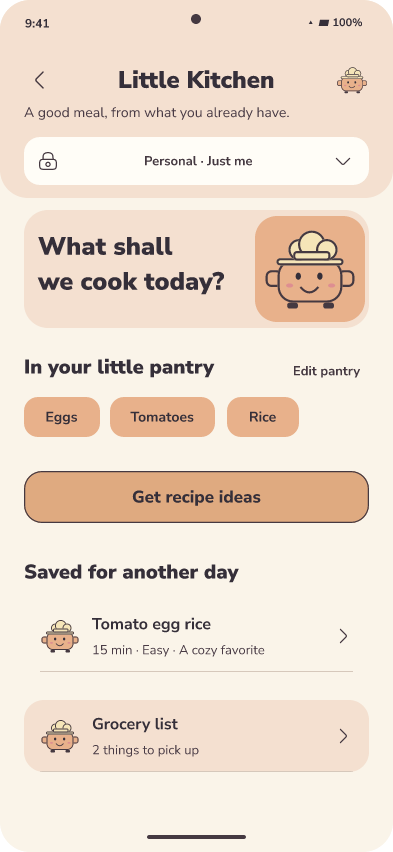

<div align="center">
  

  <h1>Alongio</h1>

  <p><strong>Your day. Your way. Better together.</strong></p>
  <p>Teman buat menjalani hari, menjaga rutinitas, dan saling ingetin hal kecil.</p>

  <p>
    <a href="#preview-desain">Preview</a> ·
    <a href="#status-pengembangan">Status</a> ·
    <a href="#teknologi">Teknologi</a> ·
    <a href="#menjalankan-proyek">Jalankan proyek</a>
  </p>

  <p><strong>Personal project · Mobile app · Sedang dikembangkan</strong></p>
</div>

---

## Tentang Alongio

Alongio adalah aplikasi lifestyle untuk dipakai sendiri atau bareng pasangan, dibangun dengan React Native, Expo, dan TypeScript. Idenya dekat dengan keseharian: ingat beli susu, tetap jalanin rutinitas, atau bantu pasangan mengingat sesuatu di tengah hari yang sibuk.

Nggak harus punya pasangan untuk pakai Alongio. Penggunaan personal tetap jadi bagian dari desainnya, dengan pilihan ruang bersama untuk pasangan. Warna pastel, maskot pixel, dan bahasa yang akrab menjaga tampilannya tetap playful.

Saya mengembangkan Alongio sebagai proyek portfolio, mulai dari desain produk sampai implementasi mobile. Di sini saya mengerjakan alur pengguna, komponen reusable, pengelolaan form, navigasi, dan animasi antarmuka.

> Alongio masih berupa prototype frontend dengan data contoh lokal. Backend, autentikasi sungguhan, sinkronisasi pasangan, penyimpanan reminder, dan pengiriman notifikasi belum terintegrasi. Preview di bawah menampilkan desain produk yang sebagian masih saya implementasikan.

## Preview desain

### Satu aplikasi untuk beberapa bagian keseharian

<table>
  <tr>
    <th>Home</th>
    <th>Little Kitchen</th>
    <th>Money Garden</th>
    <th>Me &amp; Spaces</th>
  </tr>
  <tr>
    <td><a href="docs/images/home-design.png"></a></td>
    <td><a href="docs/images/little-kitchen-design.png"></a></td>
    <td><a href="docs/images/money-garden-design.png"></a></td>
    <td><a href="docs/images/profile-design.png"></a></td>
  </tr>
</table>

Dari Home, pengguna bisa membuka fitur-fitur Alongio. Little Kitchen dirancang untuk mencari ide masak dari bahan yang ada. Money Garden menampilkan budget dan target tabungan, sementara Me & Spaces memuat profil serta ruang personal dan pasangan. Klik gambar untuk melihat ukuran penuh.

*Little Kitchen dan Money Garden masih di tahap desain. Home dan profil sudah punya prototype UI. Detail fitur yang sudah bisa dicoba ada di [status pengembangan](#status-pengembangan).*

### Tiny Planner: reminder harian dan rutinitas


Lupa beli susu atau perlu ambil paket? Reminder sekali jalan seperti ini masuk ke Today. Untuk kebiasaan yang diulang, Routines dirancang dengan progres harian dan apresiasi setelah semua rutinitas hari itu selesai. Centang reminder di Today tidak menambah progres Routines.

<details>
<summary>Pilih siapa yang mau diingetin</summary>


Lewat field For, pengguna bisa membuka bottom sheet lalu memilih diri sendiri, pasangan, atau keduanya. Tiap pilihan punya nama, avatar, dan deskripsi singkat, jadi penerimanya tetap jelas tanpa harus menebak dari warna.

</details>

*Semua preview diekspor dari desain FigCraft. Aplikasinya belum dirilis.*

## Keputusan produk dan UI

| Kebutuhan | Pendekatan desain |
| --- | --- |
| Membedakan aktivitas mendadak dan kebiasaan | Memisahkan **Today** untuk reminder dan **Routines** untuk aktivitas berulang. |
| Memahami jadwal milik siapa | Menampilkan avatar dan nama pada kartu, tanpa menambah tab pemilik. |
| Mengurangi kepadatan form | Memindahkan pilihan penerima ke satu field dengan bottom sheet. |
| Membuat status selesai mudah dikenali | Menggunakan centang, judul dicoret, dan keterangan **Done**. |
| Memberi dorongan untuk menjaga rutinitas | Menampilkan progres pribadi dan apresiasi setelah rutinitas hari itu tuntas. |
| Tetap berguna tanpa pasangan | Menjadikan penggunaan personal sebagai bagian dari konsep produk. |

## Status pengembangan

| Area | Yang tersedia sekarang | Status |
| --- | --- | --- |
| Home | Sapaan, ilustrasi, kartu fitur, dan tampilan ruang personal | Prototype UI |
| Profil | Tampilan profil dan personal space dengan data contoh | Prototype UI |
| Navigasi | Stack navigation dan bottom tab custom | Diimplementasikan untuk layar yang sudah terdaftar |
| Autentikasi | Layar greeting, register, login, dan verifikasi; validasi form registrasi | UI tersedia, belum terhubung backend |
| Tiny Planner: Today | Daftar reminder contoh, tanggal relatif, dan tampilan status selesai | Prototype UI dengan data lokal |
| Form reminder | Input nama reminder dan pilihan penerima menggunakan React Hook Form | Implementasi awal; belum menyimpan reminder |
| Tiny Planner: Routines | Alur progres, penyelesaian, undo, dan apresiasi | Tersedia di desain FigCraft; belum diimplementasikan di aplikasi |
| Backend dan notifikasi | Akun, persistensi, sinkronisasi, dan pengiriman pengingat | Direncanakan |

Beberapa kontrol masih menampilkan data statis. Checkbox pada daftar mengikuti status dari data contoh dan belum menyimpan perubahan. Repository ini juga belum menyertakan rilis APK atau tautan App Store.

## Teknologi

| Teknologi | Penggunaan |
| --- | --- |
| **Expo SDK 58** | Tooling dan workflow pengembangan mobile |
| **React Native 0.88 / React 19** | Antarmuka aplikasi |
| **TypeScript** | Tipe komponen, data, dan navigasi |
| **React Navigation 7** | Native stack dan bottom tabs |
| **React Hook Form 7** | Kontrol input dan validasi form |
| **React Native Reanimated 4 / Worklets** | Animasi tab dan interaksi antarmuka |
| **date-fns 4** | Format tanggal dan waktu reminder |
| **Expo Image / Expo Font** | Aset WebP dan font Nunito Sans |
| **Iconsax / React Native SVG** | Ikon yang konsisten dengan desain |
| **FigCraft** | Desain layar, state, dan prototype interaksi |

Versi lengkap dependency bisa dilihat di [`package.json`](package.json).

## Menjalankan proyek

### Prasyarat

- Node.js **22.x, minimal 22.13.0**, dan npm.
- Expo Go yang kompatibel dengan SDK proyek, atau lingkungan development build yang sesuai.
- Perangkat Android/iOS atau emulator. iOS Simulator memerlukan macOS.

### Instalasi

```bash
git clone https://github.com/TioNovriadiPutra/alongio-app.git
cd alongio-app
npm ci
npm start
```

Scan QR code dari development server lewat Expo Go yang kompatibel. Kalau memakai ponsel fisik, pastikan komputer dan ponsel terhubung ke jaringan yang sama.

| Perintah | Kegunaan |
| --- | --- |
| `npm start` | Menjalankan Expo development server |
| `npm run android` | Menjalankan development server dan membuka target Android |
| `npm run ios` | Menjalankan development server dan membuka iOS Simulator pada macOS |
| `npx tsc --noEmit` | Memeriksa tipe TypeScript tanpa menghasilkan file build |

Prototype ini bisa dijalankan tanpa konfigurasi backend atau file `.env`. Entry point di [`App.tsx`](App.tsx) langsung membuka `AppRoute`. Layar autentikasi ada di `AuthRoute`, tetapi belum dipakai sebagai alur awal aplikasi.

Untuk mencoba alur yang sedang dikerjakan, buka Home → Tiny Planner → Add reminder. Fitur di luar Tiny Planner masih dikembangkan, jadi beberapa kartu menu belum punya screen tujuan yang terdaftar.

Panduan menjalankan development server: [dokumentasi Expo](https://docs.expo.dev/get-started/start-developing/).

## Struktur proyek

```text
alongio-app/
├── App.tsx                 # Entry aplikasi, font, dan navigation container
├── assets/
│   ├── fonts/              # Nunito Sans
│   └── images/             # Ilustrasi, avatar, dan ikon fitur
├── docs/
│   ├── architecture.md     # Arah arsitektur dan tanggung jawab layer
│   ├── mvp.md              # Visi produk dan cakupan MVP
│   └── images/             # Preview desain untuk dokumentasi
└── src/
    ├── components/
    │   ├── custom/         # Komponen khusus fitur
    │   └── shared/         # Input, button, checkbox, dan komponen bersama
    ├── interfaces/         # Tipe data yang digunakan aplikasi
    ├── lib/                # Helper, data contoh, dan definisi navigasi
    ├── pages/
    │   ├── app/            # Home, profil, dan Tiny Planner
    │   └── auth/           # Greeting, register, login, dan verifikasi
    └── routes/             # App route dan auth route
```

Struktur ini mengikuti isi proyek saat ini. Layer backend dan server state yang dibahas dalam dokumen arsitektur masih berupa rencana pengembangan.

## Roadmap

- [ ] Menyelesaikan pembuatan, perubahan, dan penghapusan reminder.
- [ ] Menyimpan status selesai dan menjaga data setelah aplikasi dibuka ulang.
- [ ] Mengimplementasikan jadwal berulang, progres Routines, dan apresiasi harian.
- [ ] Menghubungkan autentikasi dan profil ke backend.
- [ ] Mengimplementasikan personal/couple space beserta batas akses datanya.
- [ ] Mengintegrasikan notifikasi dan pengingat pasangan.
- [ ] Memvalidasi aksesibilitas, layout perangkat kecil, dan perilaku Android/iOS.

Alongio juga punya konsep Little Kitchen, Money Garden, Heart Diary, Playroom, dan Buddy AI. Kartu fiturnya sudah masuk ke desain, sementara implementasi modulnya belum lengkap. Cakupan masing-masing fitur ada di [dokumen MVP](docs/mvp.md).

## Dokumentasi

- [Visi produk dan cakupan MVP](docs/mvp.md)
- [Arah arsitektur proyek](docs/architecture.md)
- [Galeri Home, Little Kitchen, Money Garden, dan profil](#satu-aplikasi-untuk-beberapa-bagian-keseharian)
- [Preview desain Tiny Planner](docs/images/tiny-planner-design.png)
- [Preview pemilihan penerima reminder](docs/images/reminder-recipient-design.png)

File FigCraft yang bisa diedit disimpan lokal di `output/` dan tidak masuk ke repository publik. Preview PNG tetap bisa dilihat langsung di GitHub.

## Pengembang

Dibuat oleh [TioNovriadiPutra](https://github.com/TioNovriadiPutra) sebagai proyek personal untuk mengeksplorasi pengembangan produk mobile dan implementasi UI dengan React Native.

Punya masukan soal pengalaman pengguna, interaksi, atau implementasi mobile? Diskusikan lewat [GitHub Issues](https://github.com/TioNovriadiPutra/alongio-app/issues).

## Lisensi

Repository ini menyertakan [MIT License](LICENSE). Ketentuan penggunaan dan atribusinya ada di file tersebut.
