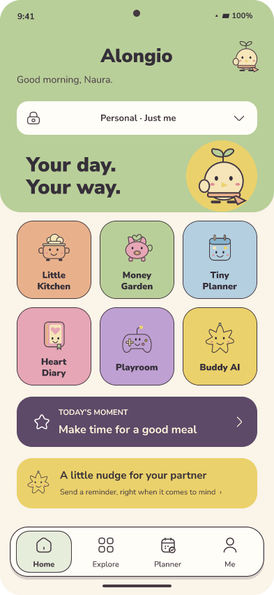
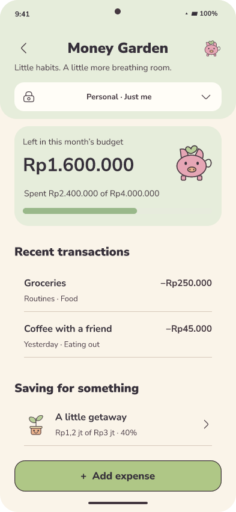
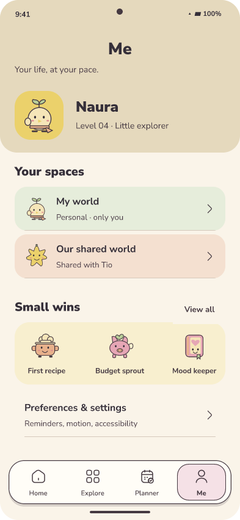
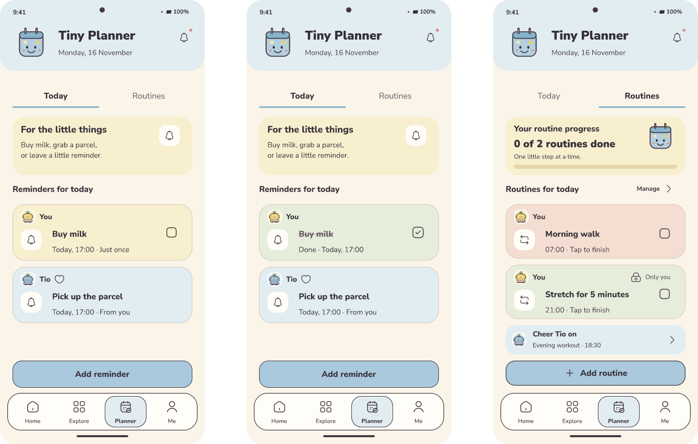

<div align="center">
  

  <h1>Alongio</h1>

  <p><strong>Your day. Your way. Better together.</strong></p>
  <p>A little companion for daily routines, everyday reminders, and checking in on your person.</p>

  <p>
    <a href="#preview-desain">Preview</a> ·
    <a href="#status-pengembangan">Status</a> ·
    <a href="#teknologi">Tech stack</a> ·
    <a href="#menjalankan-proyek">Run locally</a>
  </p>

  <p><strong>Personal project · Mobile app · Work in progress</strong></p>
</div>

---

## About Alongio

Alongio is a lifestyle app for solo use or life with a partner, built with React Native, Expo, and TypeScript. It's designed around everyday things: remembering to buy milk, sticking with a routine, or giving your person a heads-up during a busy day.

Solo use is part of the design from the start, with shared spaces planned for couples. Pastel colors, a pixel mascot, and friendly copy keep the experience playful.

I'm building Alongio as a portfolio project, from product design through mobile implementation. It gives me room to work on user flows, reusable components, forms, navigation, and UI animation in the same product.

> Alongio is currently a frontend prototype with local sample data. Backend services, real authentication, partner sync, reminder storage, and notification delivery aren't connected yet. The previews below show product designs that I'm still bringing into the app.

<a id="preview-desain"></a>

## Design previews

<a id="satu-aplikasi-untuk-beberapa-bagian-keseharian"></a>

### A few corners of everyday life

<table>
  <tr>
    <th>Home</th>
    <th>Little Kitchen</th>
    <th>Money Garden</th>
    <th>Me &amp; Spaces</th>
  </tr>
  <tr>
    <td><a href="docs/images/home-design.png"></a></td>
    <td><a href="docs/images/little-kitchen-design.png"></a></td>
    <td><a href="docs/images/money-garden-design.png"></a></td>
    <td><a href="docs/images/profile-design.png"></a></td>
  </tr>
</table>

Home is the starting point for Alongio's features. Little Kitchen is designed around meal ideas using ingredients you already have. Money Garden visualizes budgets and savings goals, while Me & Spaces holds your profile and personal or shared spaces. Click any image for the full-size preview.

*Little Kitchen and Money Garden are still at the design stage. Home and the profile already have UI prototypes. See [development status](#status-pengembangan) for what's available to try.*

### Tiny Planner: daily reminders and routines



Need to buy milk or pick up a package? One-time reminders like these go in Today. Routines is designed for recurring habits, with daily progress and a little celebration when everything for the day is done. Checking off a reminder in Today doesn't add to routine progress.

<details>
<summary>Choose who gets the reminder</summary>


The For field opens a bottom sheet where you can choose yourself, your partner, or both. Each option includes a name, avatar, and short description, so you can tell who it's for without relying on color.

</details>

*All previews are exported from the FigCraft design. The app hasn't been released yet.*

## Product and UI decisions

| Need | Design choice |
| --- | --- |
| Keep one-off tasks separate from habits | Today holds reminders; Routines holds recurring activities. |
| Show whose schedule an item belongs to | Names and avatars appear on cards, without extra owner tabs. |
| Keep the form compact | A single recipient field opens a bottom sheet. |
| Make completion easy to recognize | A checkmark, strikethrough title, and Done label show the completed state. |
| Encourage people to keep up with routines | Personal progress and a celebration mark the day's completed routines. |
| Support solo use | Personal use is part of the product concept. |

<a id="status-pengembangan"></a>

## Development status

| Area | What's available now | Status |
| --- | --- | --- |
| Home | Greeting, illustration, feature cards, and a personal space view | UI prototype |
| Profile | Profile and personal space views with sample data | UI prototype |
| Navigation | Stack navigation and custom bottom tabs | Implemented for registered screens |
| Authentication | Greeting, registration, login, and verification screens; registration form validation | UI available; backend not connected |
| Tiny Planner: Today | Sample reminders, relative dates, and completed states | UI prototype with local data |
| Reminder form | Reminder name and recipient fields using React Hook Form | Early implementation; reminders aren't saved yet |
| Tiny Planner: Routines | Progress, completion, undo, and celebration flows | Available in FigCraft; not implemented in the app yet |
| Backend and notifications | Accounts, persistence, sync, and reminder delivery | Planned |

Some controls still display static data. List checkboxes reflect the sample data and don't save changes yet. This repository doesn't include an APK release or an App Store link.

<a id="teknologi"></a>

## Tech stack

| Technology | Used for |
| --- | --- |
| Expo SDK 58 | Mobile development tooling and workflow |
| React Native 0.88 / React 19 | App UI |
| TypeScript | Component, data, and navigation types |
| React Navigation 7 | Native stack and bottom tabs |
| React Hook Form 7 | Form inputs and validation |
| React Native Reanimated 4 / Worklets | Tab animations and UI interactions |
| date-fns 4 | Reminder date and time formatting |
| Expo Image / Expo Font | WebP assets and the Nunito Sans font |
| Iconsax / React Native SVG | Icons consistent with the design |
| FigCraft | Screen design, UI states, and interaction prototypes |

Full dependency versions are listed in [`package.json`](package.json).

<a id="menjalankan-proyek"></a>

## Run locally

### Prerequisites

- Node.js **22.x, at least 22.13.0**, and npm.
- Expo Go compatible with the project's SDK, or a suitable development build setup.
- An Android/iOS device or emulator. The iOS Simulator requires macOS.

### Installation

```bash
git clone https://github.com/TioNovriadiPutra/alongio-app.git
cd alongio-app
npm ci
npm start
```

Scan the development server's QR code with a compatible version of Expo Go. If you're using a physical phone, connect it to the same network as your computer.

| Command | What it does |
| --- | --- |
| `npm start` | Starts the Expo development server |
| `npm run android` | Starts the development server and opens the Android target |
| `npm run ios` | Starts the development server and opens the iOS Simulator on macOS |
| `npx tsc --noEmit` | Checks TypeScript types without generating build files |

The prototype runs without backend configuration or a `.env` file. The entry point in [`App.tsx`](App.tsx) opens `AppRoute` directly. Authentication screens exist in `AuthRoute`, but aren't part of the startup flow yet.

To try the flow I'm working on, open Home → Tiny Planner → Add reminder. Features outside Tiny Planner are still in development, so some menu cards don't have registered destination screens yet.

For more on the development server, see the [Expo documentation](https://docs.expo.dev/get-started/start-developing/).

## Project structure

```text
alongio-app/
├── App.tsx                 # App entry point, fonts, and navigation container
├── assets/
│   ├── fonts/              # Nunito Sans
│   └── images/             # Illustrations, avatars, and feature icons
├── docs/
│   ├── architecture.md     # Architecture direction and layer responsibilities
│   ├── mvp.md              # Product vision and MVP scope
│   └── images/             # Design previews for documentation
└── src/
    ├── components/
    │   ├── custom/         # Feature-specific components
    │   └── shared/         # Inputs, buttons, checkboxes, and shared components
    ├── interfaces/         # App data types
    ├── lib/                # Helpers, sample data, and navigation definitions
    ├── pages/
    │   ├── app/            # Home, profile, and Tiny Planner
    │   └── auth/           # Greeting, registration, login, and verification
    └── routes/             # App and auth routes
```

This structure reflects the current project. The backend and server state layers discussed in the architecture document are still planned.

## Roadmap

- [ ] Finish creating, editing, and deleting reminders.
- [ ] Save completion states and keep data between app sessions.
- [ ] Implement recurring schedules, Routines progress, and daily celebrations.
- [ ] Connect authentication and profiles to the backend.
- [ ] Implement personal/couple spaces and their data access boundaries.
- [ ] Add notifications and partner reminders.
- [ ] Check accessibility, small-screen layouts, and Android/iOS behavior.

Alongio also includes concepts for Little Kitchen, Money Garden, Heart Diary, Playroom, and Buddy AI. Their feature cards are part of the design, while the modules aren't fully implemented yet. Each feature's scope is covered in the [MVP document](docs/mvp.md).

## Documentation

- [Product vision and MVP scope](docs/mvp.md)
- [Architecture direction](docs/architecture.md)
- [Home, Little Kitchen, Money Garden, and profile gallery](#satu-aplikasi-untuk-beberapa-bagian-keseharian)
- [Tiny Planner design preview](docs/images/tiny-planner-design.png)
- [Reminder recipient selection preview](docs/images/reminder-recipient-design.png)

The editable FigCraft file is stored locally in `output/` and isn't included in the public repository. The PNG previews are available directly on GitHub.

## Developer

Built by [TioNovriadiPutra](https://github.com/TioNovriadiPutra) as a personal project to explore mobile product development and UI implementation with React Native.

Have feedback on the user experience, interactions, or mobile implementation? Start a discussion through [GitHub Issues](https://github.com/TioNovriadiPutra/alongio-app/issues).

For a chat about the project or a potential collaboration, reach me here:

- Instagram: [@tio_novriadi](https://www.instagram.com/tio_novriadi/)
- Email: [tionvriadi@gmail.com](mailto:tionvriadi@gmail.com)

## License

This repository includes the [MIT License](LICENSE). See the file for usage terms and attribution.
